# Hardening Windows

Automação segura e rastreável de 16 controles de segurança do Windows, a partir do checklist de assertivas de Rodrigo Campos e Gabriel Cortez.

Projeto de extensão · UPE / POLI · Sistemas Operacionais 2026.2 · Prof.ª Tarciana Dias da Silva
Grupo 2: Sofia Queiroz, Mateus Cunha e Vinícius Ribeiro

[](https://github.com/Vjfrib/hardening-windows/actions/workflows/ci.yml)

> Perfil acadêmico, sem homologação institucional. Hardening reduz a superfície de ataque; não garante invulnerabilidade.

## Documentos

| Documento | Arquivo |
|-----------|---------|
| Apresentação (PDF, versão final) | [apresentacao/Apresentacao_Hardening_Windows_Grupo2.pdf](apresentacao/Apresentacao_Hardening_Windows_Grupo2.pdf) |
| Roteiro de fala da apresentação | [apresentacao/roteiro-de-fala.md](apresentacao/roteiro-de-fala.md) |
| Relatório técnico (PDF, versão final) | [docs/Relatorio_Tecnico_Hardening_Windows_Grupo2.pdf](docs/Relatorio_Tecnico_Hardening_Windows_Grupo2.pdf) |
| Matriz dos 16 controles | [docs/matriz-controles.md](docs/matriz-controles.md) |
| Plano de testes e evidências | [docs/plano-de-testes.md](docs/plano-de-testes.md) |
| Riscos e limitações | [docs/riscos-e-limitacoes.md](docs/riscos-e-limitacoes.md) |
| Entrega para o grupo de riscos e ataques | [docs/handoff-riscos-e-ataques.md](docs/handoff-riscos-e-ataques.md) |
| Créditos do checklist | [referencias/checklist-creditos.md](referencias/checklist-creditos.md) |

## Apresentação

Os slides abaixo são as páginas do [PDF da apresentação](apresentacao/Apresentacao_Hardening_Windows_Grupo2.pdf). O slide 14 não faz parte da versão final. Os trechos de código citados nos slides 08 a 13 (por exemplo `scripts/controles/01-SenhaMinima.ps1:31`) apontam para as linhas reais deste repositório, e a CI confere isso a cada commit.

<p align="center">
  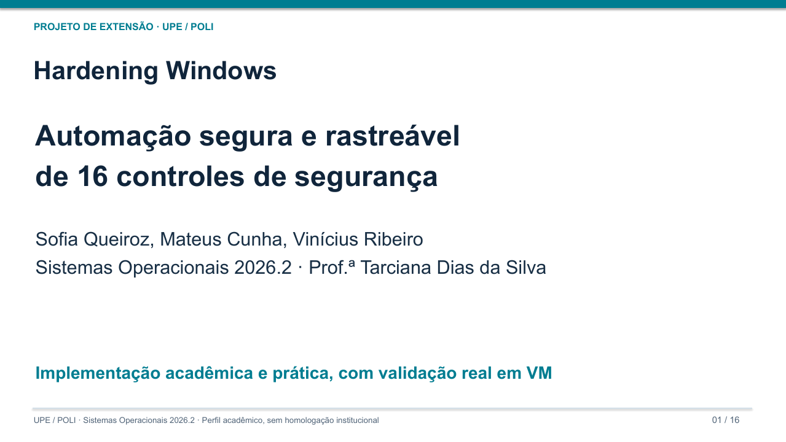
</p>

<p>
  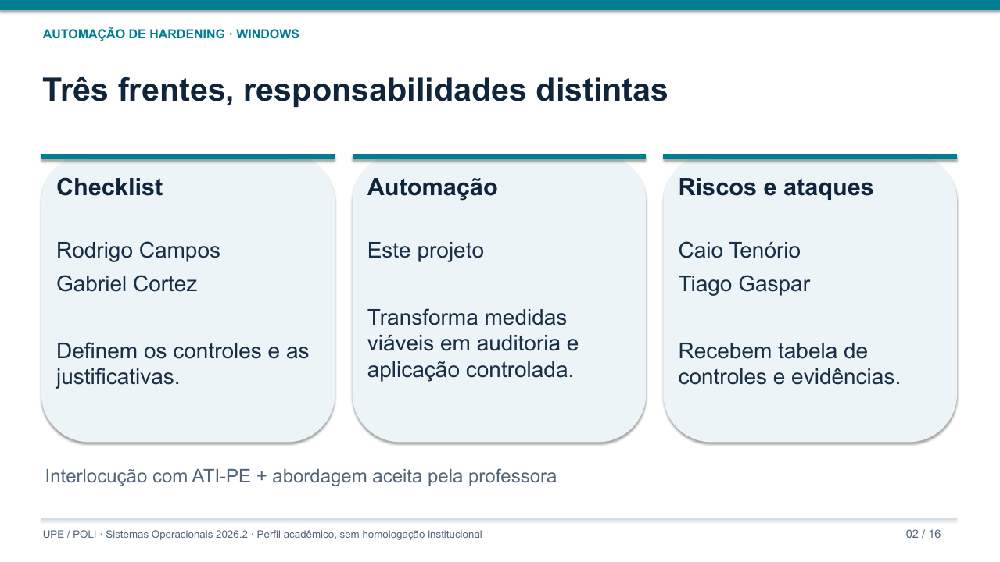
  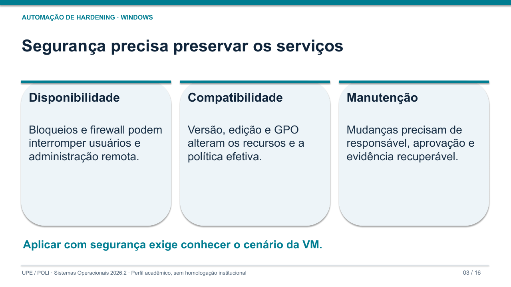
</p>
<p>
  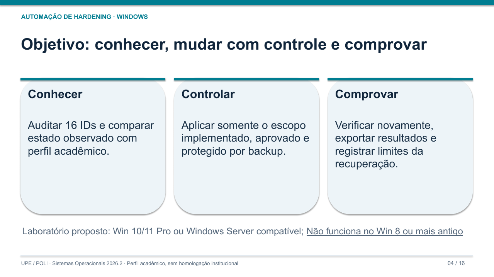
  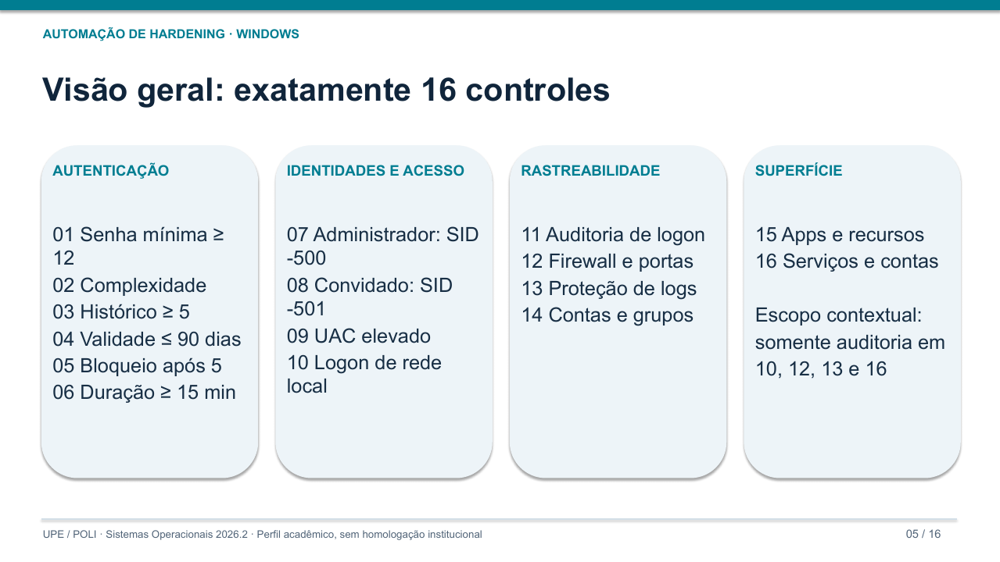
</p>
<p>
  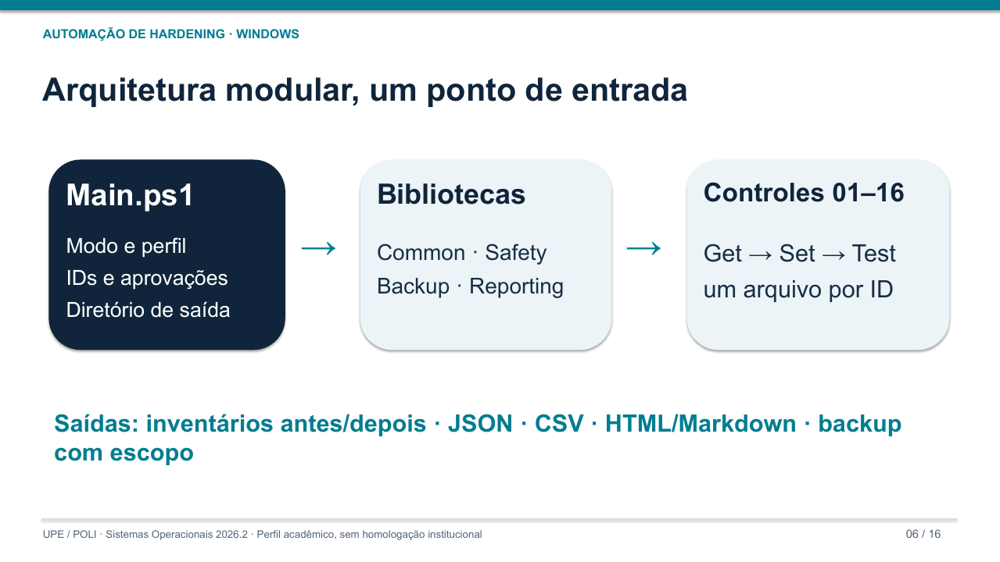
  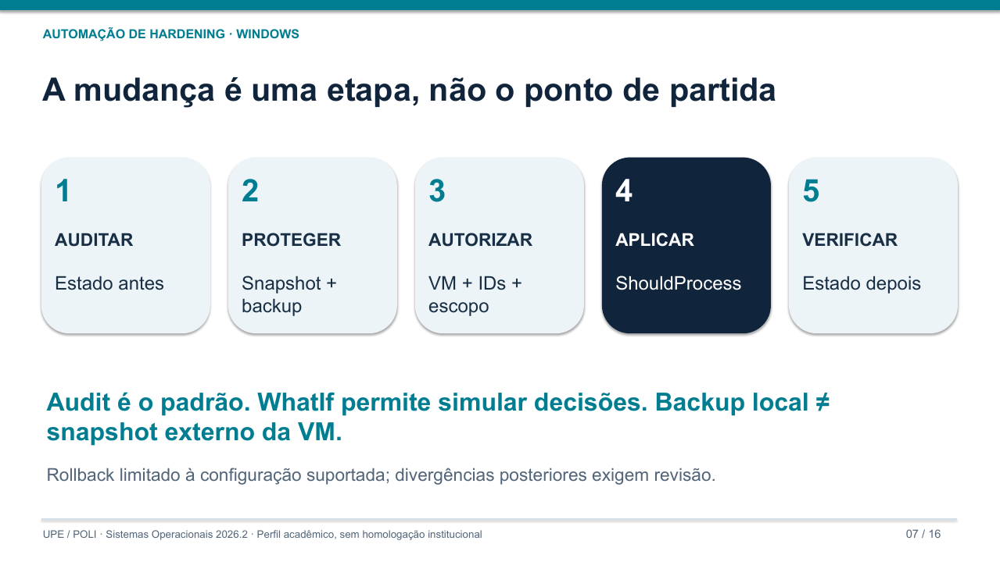
</p>
<p>
  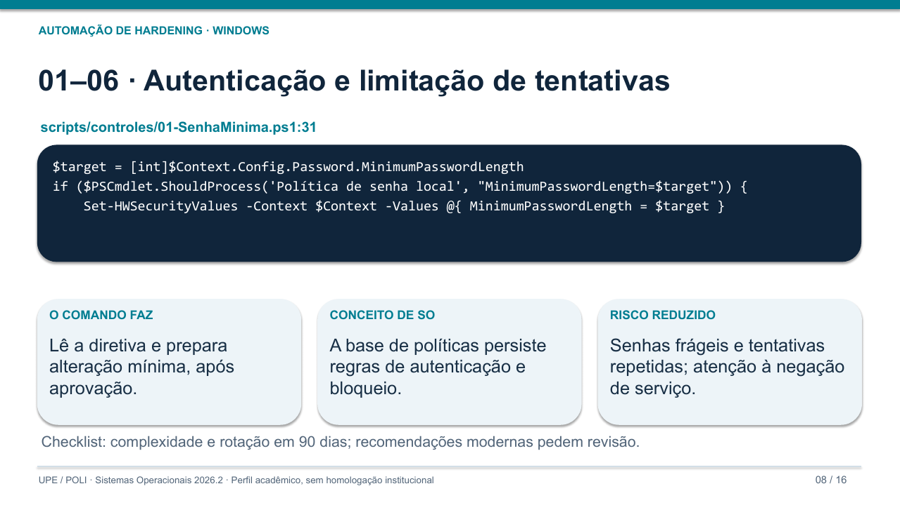
  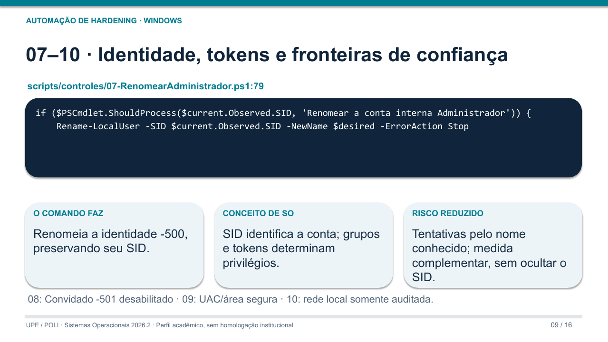
</p>
<p>
  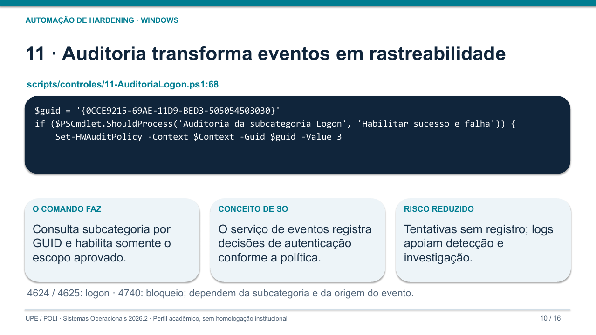
  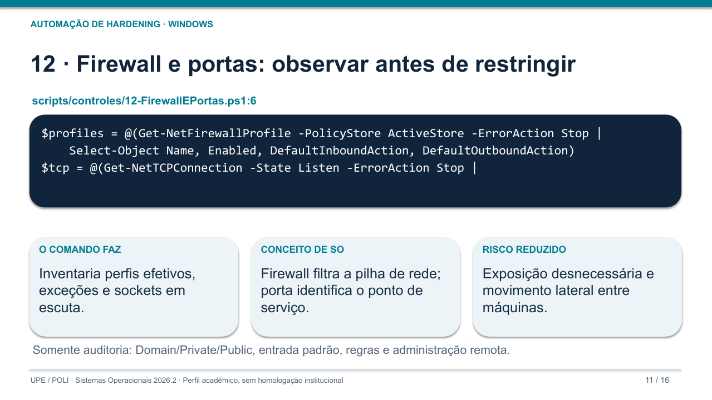
</p>
<p>
  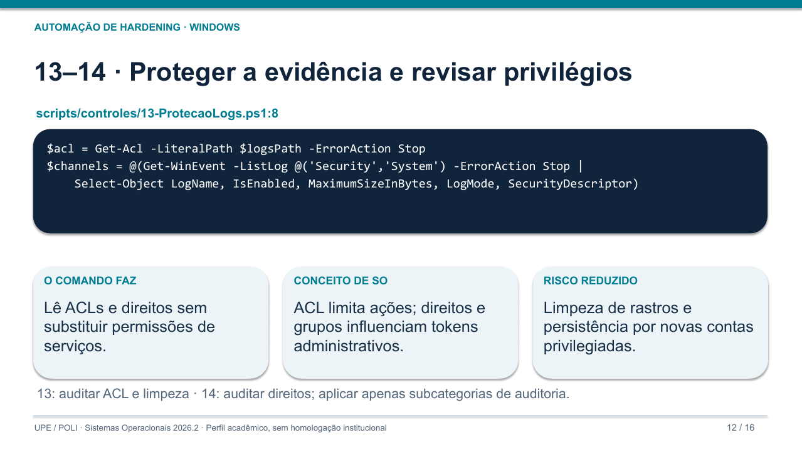
  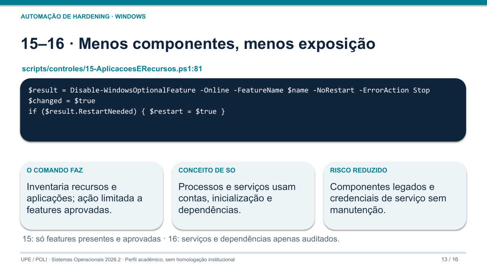
</p>
<p>
  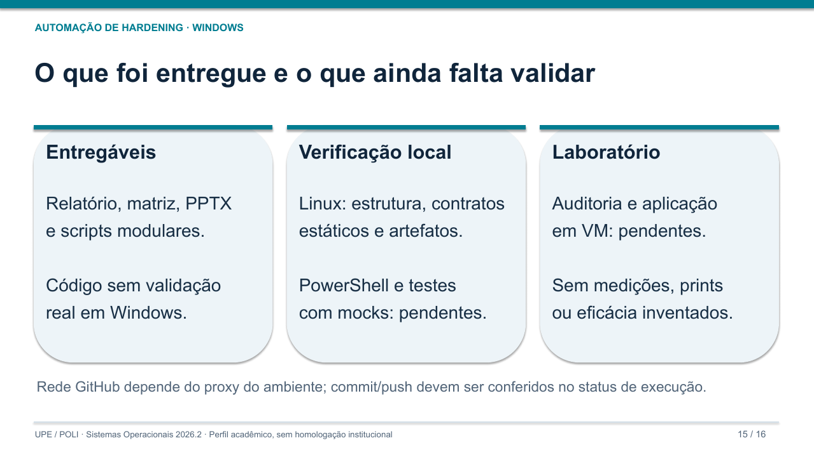
  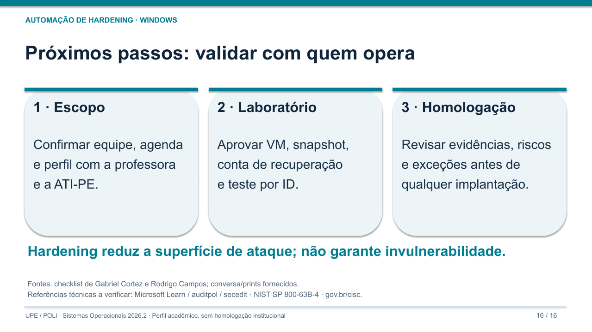
</p>

O slide 15 mostra o estado na data da apresentação. Depois dela, os testes com dublês (Pester) e a execução real em Windows pela CI foram concluídos; veja [Testes](#testes).

## Os 16 controles

| ID | Controle | Audita (Get) | Aplica (Set), com aprovação | Arquivo |
|----|----------|--------------|------------------------------|---------|
| 01 | Senha mínima ≥ 12 | `MinimumPasswordLength` (secedit) | Ajusta só essa chave | [01-SenhaMinima.ps1](scripts/controles/01-SenhaMinima.ps1) |
| 02 | Complexidade | `PasswordComplexity` | Habilita | [02-ComplexidadeSenha.ps1](scripts/controles/02-ComplexidadeSenha.ps1) |
| 03 | Histórico ≥ 5 | `PasswordHistorySize` | Ajusta | [03-HistoricoSenhas.ps1](scripts/controles/03-HistoricoSenhas.ps1) |
| 04 | Validade ≤ 90 dias | `MaximumPasswordAge` | Ajusta | [04-ValidadeSenha.ps1](scripts/controles/04-ValidadeSenha.ps1) |
| 05 | Bloqueio após 5 tentativas | `LockoutBadCount`, `ResetLockoutCount` | Ajusta limite e janela | [05-LimiteTentativas.ps1](scripts/controles/05-LimiteTentativas.ps1) |
| 06 | Duração do bloqueio ≥ 15 min | `LockoutDuration` | Ajusta | [06-DuracaoBloqueio.ps1](scripts/controles/06-DuracaoBloqueio.ps1) |
| 07 | Renomear Administrador (SID -500) | Nome da conta -500 | Renomeia pelo SID para o nome aprovado | [07-RenomearAdministrador.ps1](scripts/controles/07-RenomearAdministrador.ps1) |
| 08 | Desabilitar Convidado (SID -501) | Conta -501 habilitada? | Desabilita pelo SID | [08-DesabilitarConvidado.ps1](scripts/controles/08-DesabilitarConvidado.ps1) |
| 09 | UAC elevado e área segura | `EnableLUA`, `ConsentPromptBehaviorAdmin`, `PromptOnSecureDesktop` | Ajusta os valores divergentes | [09-UAC.ps1](scripts/controles/09-UAC.ps1) |
| 10 | Logon de rede de contas locais | Direitos `SeDenyNetworkLogonRight` etc. | Somente auditoria | [10-LogonRedeContasLocais.ps1](scripts/controles/10-LogonRedeContasLocais.ps1) |
| 11 | Auditoria de logon | Subcategorias Logon e Bloqueio de conta (auditpol, por GUID) | Habilita sucesso e falha | [11-AuditoriaLogon.ps1](scripts/controles/11-AuditoriaLogon.ps1) |
| 12 | Firewall e portas | Perfis, entrada padrão, portas em escuta | Somente auditoria | [12-FirewallEPortas.ps1](scripts/controles/12-FirewallEPortas.ps1) |
| 13 | Proteção de logs | ACL da pasta de logs, tamanho, limpezas (1102/104) | Somente auditoria | [13-ProtecaoLogs.ps1](scripts/controles/13-ProtecaoLogs.ps1) |
| 14 | Contas e grupos | Contas, grupos privilegiados, direitos sensíveis | Só as subcategorias de auditoria de contas e grupos | [14-UsuariosEGrupos.ps1](scripts/controles/14-UsuariosEGrupos.ps1) |
| 15 | Aplicações e recursos | Aplicações instaladas, recursos opcionais | Desabilita só recursos aprovados | [15-AplicacoesERecursos.ps1](scripts/controles/15-AplicacoesERecursos.ps1) |
| 16 | Serviços e contas de serviço | Contas de serviço, caminhos sem aspas, serviços de risco | Somente auditoria | [16-ServicosEContasServico.ps1](scripts/controles/16-ServicosEContasServico.ps1) |

Detalhes de cada um (conceito de SO, risco reduzido, eventos, rollback e pendências com a ATI-PE) em [docs/matriz-controles.md](docs/matriz-controles.md).

## Como usar

Requisitos: Windows 10/11 Pro ou Windows Server compatível (build 10240 ou maior; não funciona no Windows 8 ou anterior), Windows PowerShell 5.1 aberto **como Administrador**, de preferência numa VM com snapshot.

```powershell
# Na raiz do projeto, liberar scripts só nesta janela
Set-ExecutionPolicy -Scope Process -ExecutionPolicy Bypass

# 1. Auditar (padrão; não altera nada)
.\Main.ps1
.\Main.ps1 -Mode Audit -ControlIds '01','07','09','12'

# 2-3. Proteger e autorizar: tire um snapshot da VM e preencha a aprovação
Copy-Item .\scripts\config\aprovacoes.example.json .\scripts\config\aprovacoes.json
notepad .\scripts\config\aprovacoes.json

# 4. Simular e depois aplicar (cada mudança pede confirmação)
.\Main.ps1 -Mode Apply -ControlIds '01','02','03' -WhatIf
.\Main.ps1 -Mode Apply -ControlIds '01','02','03'

# Desfazer o que a aplicação mudou (usa o backup gravado por ela)
.\Main.ps1 -Mode Rollback -BackupPath .\saida\<pasta-da-aplicacao>\backup
```

Cada execução cria `saida\<data>-<modo>\` com `estado-antes.json`, `estado-depois.json`, `resultados.json`, `resultados.csv`, `relatorio.md`, `relatorio.html`, `execucao.log` e, quando aplica, `backup\`.

Códigos de saída: `0` sem não conformidades · `1` há não conformidades · `2` erro em algum controle · `3` execução bloqueada pelas travas.

### Perfil e aprovação

- **Perfil** ([scripts/config/perfil-academico.example.json](scripts/config/perfil-academico.example.json)): os valores esperados. O script recusa perfis mais fracos que o checklist. Para personalizar, copie para `perfil-academico.json` (não versionado). Campos pendentes com a ATI-PE: `Accounts.AdministratorNewName` (07), `Accounts.ApprovedAdministrators` (14), `Firewall.AllowedListeningPorts` (12), `Features.ApprovedToDisable` (15).
- **Aprovação** ([scripts/config/aprovacoes.example.json](scripts/config/aprovacoes.example.json)): exigida pelo modo Apply. Precisa de responsável, nome desta máquina, validade, confirmação de laboratório, de snapshot e de conta de recuperação, e a lista de IDs aprovados. O exemplo não autoriza nada.

### Travas antes de qualquer mudança

O modo Apply só altera um controle quando tudo isto vale ao mesmo tempo: Windows suportado e fora de domínio, PowerShell como Administrador, aprovação válida para esta máquina, máquina virtual (ou autorização explícita), ID aprovado, controle não conforme na auditoria, backup gravado e confirmação do `ShouldProcess`. Os controles 10, 12, 13 e 16 nunca alteram nada.

## Arquitetura

```
Main.ps1                       modo, perfil, IDs, aprovação, diretório de saída
  └─ scripts/lib/
       Common.psm1             catálogo, estados, secedit, auditpol, registro, contas por SID
       Safety.psm1             plataforma, aprovação, VM, trava de execução simultânea
       Backup.psm1             backup com escopo, hash SHA-256 e impressão digital da máquina
       Reporting.psm1          JSON, CSV, Markdown e HTML
  └─ scripts/controles/NN-*.ps1  Get → Set → Test (+ Restore), um arquivo por ID
```

Fluxo do modo Apply: **1 Auditar** (estado antes) → **2 Proteger** (snapshot + backup) → **3 Autorizar** (VM + IDs + escopo) → **4 Aplicar** (`ShouldProcess`) → **5 Verificar** (estado depois). Backup local não substitui o snapshot externo da VM, e o rollback cobre só a configuração que cada controle sabe restaurar.

## Testes

| Nível | Onde roda | O que confere | Como rodar |
|-------|-----------|---------------|------------|
| Estrutura | Linux ou Windows, Python 3 | 16 arquivos, BOM UTF-8, linhas citadas nos slides, controles somente auditoria sem comandos de alteração, perfil e aprovação de exemplo seguros, links do README | `python3 tests/test_static.py -v` |
| Estático | PowerShell 5.1 ou 7 | Sintaxe de todos os scripts e PSScriptAnalyzer com as regras de compatibilidade do Windows PowerShell 5.1 (comandos e tipos do Windows 10/Server 2019) | `.\tests\Test-Static.ps1` |
| Contratos | PowerShell 5.1 ou 7, Pester 5 | 92 testes com dublês: cada Set altera só o seu escopo, respeita `-WhatIf` e restaura; travas de aprovação; backup e relatórios | `.\tests\Test-Contracts.ps1` |
| Ciclo real | Windows (CI no `windows-latest`) | Audita, simula, aplica, verifica, restaura e audita de novo; confere que tudo voltou ao estado inicial | `.\tests\Invoke-CicloLaboratorio.ps1 -SaidaDir C:\evidencias -ConfirmoVmDescartavel` |

O ciclo real **altera a máquina**: na CI ele roda num runner descartável do GitHub; na VM do laboratório, rode só com snapshot. Os relatórios de cada execução da CI ficam como artefato `evidencias-windows` na aba Actions. O plano completo, com o roteiro de evidências por ID, está em [docs/plano-de-testes.md](docs/plano-de-testes.md).

## Estrutura

```
Main.ps1                         ponto de entrada
PSScriptAnalyzerSettings.psd1    regras do analisador (compatibilidade com o 5.1)
scripts/config/                  perfil e aprovação de exemplo
scripts/lib/                     Common, Safety, Backup, Reporting
scripts/controles/               16 arquivos, IDs 01 a 16
docs/                            relatório técnico (PDF), matriz, testes, riscos, entrega, slides em PNG
apresentacao/                    apresentação (PDF) e roteiro de fala
referencias/                     créditos do checklist
tests/                           Python, PSScriptAnalyzer, Pester, ciclo de laboratório, fixtures
tools/                           render_slides.py (gera docs/slides a partir do PDF)
.github/workflows/ci.yml         CI em Linux e Windows
```

## Créditos

- Checklist de assertivas: Rodrigo Campos e Gabriel Cortez.
- Automação, documentação e apresentação: Grupo 2, Sofia Queiroz, Mateus Cunha e Vinícius Ribeiro.
- Relatório de riscos e ataques (próxima frente): Caio Tenório e Tiago Gaspar.
- Orientação: Prof.ª Tarciana Dias da Silva. Interlocução: ATI-PE.

Referências técnicas a verificar: Microsoft Learn (secedit, auditpol, LocalAccounts, NetSecurity, DISM), NIST SP 800-63B-4, gov.br/cisc.

Licença: [Apache 2.0](LICENSE).
